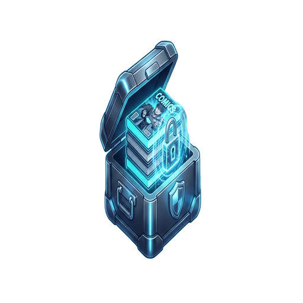

# Local Vault - Secure Encrypted File Storage & Manga Reader

**Version 2.5.0** | Professional-Grade Encrypted Storage Solution

## 🔐 Overview

Local Vault is a cross-platform (Windows & Android) encrypted file storage application with specialized manga reading capabilities. It provides military-grade AES-256 encryption for your sensitive files while maintaining an intuitive user experience.

## ✨ Key Features

### 🛡️ Security & Encryption
- **AES-256-CBC Encryption**: Military-grade encryption for all stored files
- **Secure Password Management**: Master password with recovery key support
- **Encrypted Storage**: All files encrypted at rest in secure vault
- **No Cloud Dependency**: Complete offline operation for maximum privacy

### 📁 File Management
- **Folder Organization**: Hierarchical folder structure with unlimited nesting
- **Bulk Import**: Import entire folder structures with preserved organization
- **Natural Sort**: Files maintain original order (1, 2, 3... not 1, 10, 2...)
- **Search Functionality**: Fast search across files and folders
- **Multi-Select Operations**: Batch operations on multiple files/folders

### 📱 Cross-Platform Support
- **Windows Desktop**: Full-featured desktop application with Yomikiru integration
- **Android Mobile**: Native Android app with Mihon manga reader integration
- **ZIP Export/Import**: Transfer encrypted data between devices
- **Password-Protected ZIP**: Optional password protection for exports

### 📚 Manga Reading Integration
- **Yomikiru (Windows)**: Seamless integration with Yomikiru manga reader
- **Mihon (Android)**: Direct integration with Mihon/Tachiyomi
- **Progress Tracking**: Real-time progress during temp folder creation
- **Auto-Cleanup**: Manual cleanup of temporary reading folders
- **Custom Temp Locations**: Configure temp folder locations on Android

### 🚀 Performance Optimizations
- **Hardware Acceleration**: GPU-accelerated video playback on Windows (FVP)
- **Memory Management**: Optimized for low memory usage (200MB for imports)
- **Progressive Loading**: Efficient loading of large image collections
- **Batch Processing**: Optimized batch encryption/decryption
- **Thumbnail Caching**: Fast image preview generation

### 🔄 Import/Export Features
- **Folder Import**: Import entire folder structures with encryption
- **ZIP Import**: Import password-protected or plain ZIP files
- **ZIP Export**: Export folders as encrypted ZIP files
- **Export All**: Export entire vault as single ZIP file
- **Save to Gallery**: Quick unencrypted backup to local storage
- **Android 15+ SAF**: Full Storage Access Framework support

## 📋 System Requirements

### Windows
- **OS**: Windows 10 or later (64-bit)
- **RAM**: 4GB minimum, 8GB recommended
- **Storage**: 100MB for app + space for encrypted files
- **Optional**: Yomikiru manga reader for manga integration

### Android
- **OS**: Android 6.0 (API 23) or later
- **RAM**: 2GB minimum, 4GB recommended
- **Storage**: 50MB for app + space for encrypted files
- **Permissions**: Storage access for file operations
- **Optional**: Mihon/Tachiyomi for manga reading

## 🚀 Installation

### Windows
1. Download `LocalVault-x86_64-2.5.0+5-Installer.exe`
2. Run the installer
3. Follow installation wizard
4. Launch Local Vault from Start Menu or Desktop shortcut

### Android
1. Download `app-release.apk`
2. Enable "Install from Unknown Sources" in Settings
3. Install the APK
4. Grant required storage permissions
5. Launch Local Vault

## 📖 User Guide

### First Time Setup
1. **Create Master Password**: Choose a strong password (8+ characters)
2. **Save Recovery Key**: Store recovery key in safe location
3. **Grant Permissions**: Allow storage access (Android)

### Importing Files
1. **Import Folder**: 
   - Windows: Menu → Import Folder → Select folder
   - Android: Menu → Import Folder → Select folder via SAF
2. **Import ZIP**:
   - Menu → Import ZIP → Select ZIP file
   - Enter password if ZIP is encrypted
3. **Progress Tracking**: Real-time progress shown during import

### Organizing Files
- **Create Folders**: Right-click (Windows) or long-press (Android) → New Folder
- **Move Files**: Drag & drop (Windows) or select → Move (Android)
- **Rename**: Right-click/long-press → Rename
- **Delete**: Right-click/long-press → Delete
- **Search**: Use search bar to find files/folders

### Reading Manga
**Windows (Yomikiru):**
1. Right-click folder → "Open in Yomikiru"
2. Progress dialog shows decryption status
3. Yomikiru launches automatically
4. After reading: Use cleanup dialog to remove temp files

**Android (Mihon):**
1. Long-press folder → "Open in Mihon"
2. Progress dialog shows decryption status
3. Mihon launches automatically (if installed)
4. After reading: Use cleanup dialog to remove temp files

### Exporting Data
1. **Export Folder as ZIP**:
   - Right-click folder → "Export as ZIP"
   - Choose password protection (optional)
   - Select save location
2. **Export All**:
   - Menu → Export All
   - Choose password protection
   - Creates single ZIP of entire vault
3. **Save to Gallery** (Android):
   - Menu → Save to Local Gallery
   - Creates unencrypted ZIP in Downloads

### Transferring Between Devices
1. **Windows → Android**:
   - Export folder as ZIP (no password recommended)
   - Transfer ZIP to Android device
   - Import ZIP in Android app
2. **Android → Windows**:
   - Export folder as ZIP
   - Transfer ZIP to Windows PC
   - Import ZIP in Windows app

## 🔧 Advanced Features

### Custom Temp Folder Locations (Android)
- Menu → Manga Reader Settings
- Choose from preset locations or custom path
- Recommended: `/storage/emulated/0/Manga/LocalVault`

### Storage Permissions (Android)
- Menu → Request Permissions
- Grants full storage access for Android 11+
- Required for optimal file operations

### Recovery Key
- Settings → View Recovery Key
- Use to recover vault if password forgotten
- Store securely offline

### Undo Operations
- Recent operations can be undone
- Undo button appears after delete/move operations

## 🏗️ Technical Architecture

### Encryption
- **Algorithm**: AES-256-CBC
- **Key Derivation**: PBKDF2 with 10,000 iterations
- **IV**: Unique initialization vector per file
- **Salt**: Random salt for each encryption

### Database
- **Engine**: Isar (NoSQL embedded database)
- **Schema**: Optimized for fast queries
- **Indexing**: Indexed search fields for performance

### File Storage
- **Encrypted Blobs**: Files stored as encrypted blobs
- **Metadata**: Separate metadata storage
- **Folder Structure**: Virtual folder hierarchy in database

### Performance
- **Batch Operations**: Optimized batch processing
- **Memory Streaming**: Stream-based encryption for large files
- **Progressive Loading**: Load images on-demand
- **Hardware Acceleration**: GPU acceleration where available

## 📊 Version History

### Version 2.5.0 (Current)
- ✅ New app icon and branding
- ✅ Progress dialogs for Yomikiru/Mihon integration
- ✅ Real-time decryption progress tracking
- ✅ Improved success dialogs with cleanup options
- ✅ Enhanced user experience

### Version 2.2.0
- ✅ Added progress tracking for manga reader integration
- ✅ Improved temp folder management
- ✅ Enhanced error handling

### Version 2.1.0
- ✅ Removed non-functional vault file export/import
- ✅ ZIP import/export fully functional
- ✅ FVP integration for Windows video playback
- ✅ Production-ready release

### Version 2.0.0
- ✅ Complete rewrite with modern architecture
- ✅ Cross-platform support (Windows & Android)
- ✅ Manga reader integration
- ✅ Performance optimizations

## 🐛 Troubleshooting

### Windows Issues
**Yomikiru not launching:**
- Ensure Yomikiru is installed
- Check temp folder path in success dialog
- Manually navigate to temp folder in Yomikiru

**Installation fails:**
- Run installer as Administrator
- Disable antivirus temporarily
- Check Windows version (10+ required)

### Android Issues
**Import fails:**
- Grant storage permissions
- Check available storage space
- Try smaller batches for large imports

**Mihon not launching:**
- Install Mihon from official source
- Check temp folder location in settings
- Manually open Mihon and navigate to temp folder

**Out of Memory:**
- Use ZIP export without password (uses 200MB vs 1.2GB+)
- Close other apps before large operations
- Restart device if issues persist

## 🔒 Security Best Practices

1. **Strong Password**: Use 12+ characters with mixed case, numbers, symbols
2. **Recovery Key**: Store recovery key offline in secure location
3. **Regular Backups**: Export vault regularly to external storage
4. **Temp Cleanup**: Always cleanup temp folders after manga reading
5. **Device Security**: Use device lock screen protection
6. **No Cloud Sync**: Keep vault files local only

## 📄 License

Copyright © 2024 Local Vault Developer. All rights reserved.

This software is proprietary and confidential. Unauthorized copying, distribution, or modification is strictly prohibited.

## 🤝 Support

For support, feature requests, or bug reports:
- Email: [Your support email]
- GitHub: [Your repository URL]
- Documentation: See BUILD_INSTRUCTIONS.md for development setup

## 🙏 Acknowledgments

- **Flutter**: Cross-platform framework
- **Isar**: High-performance database
- **FVP**: Hardware-accelerated video playback
- **Yomikiru**: Windows manga reader
- **Mihon**: Android manga reader

---

**Built with ❤️ for secure file storage and manga reading**
